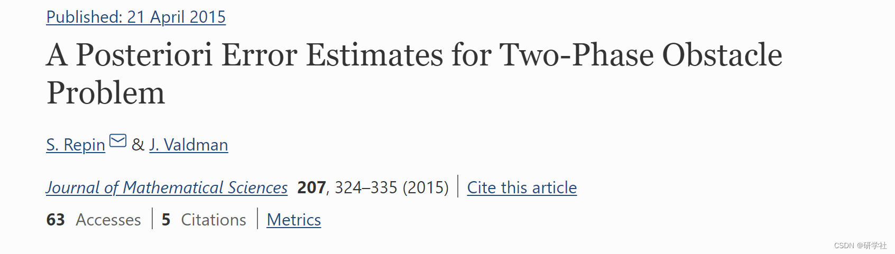
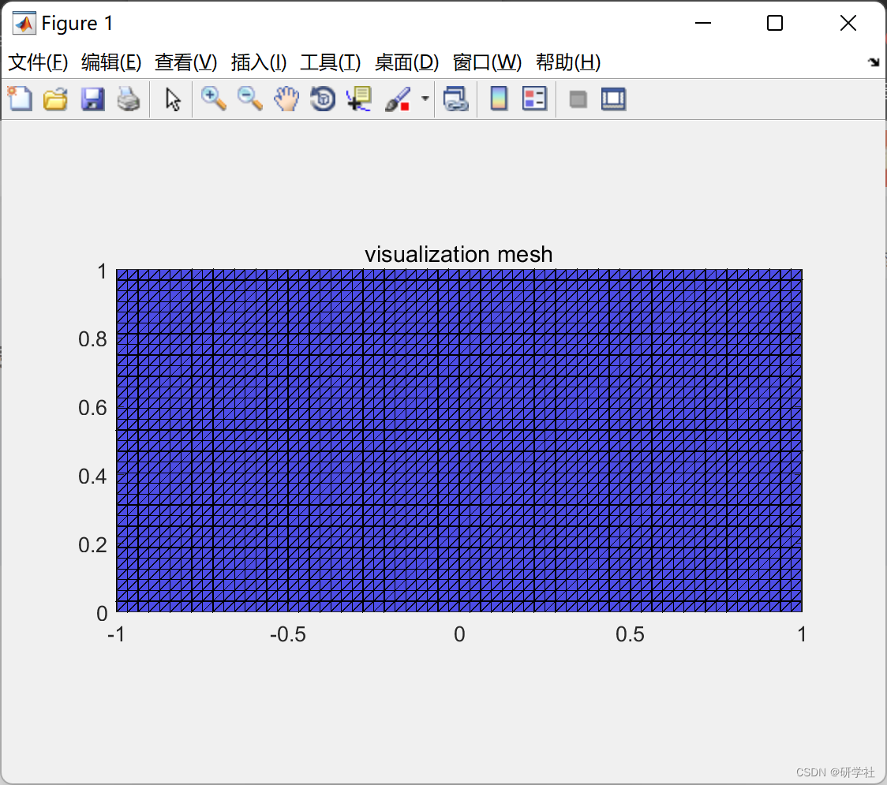
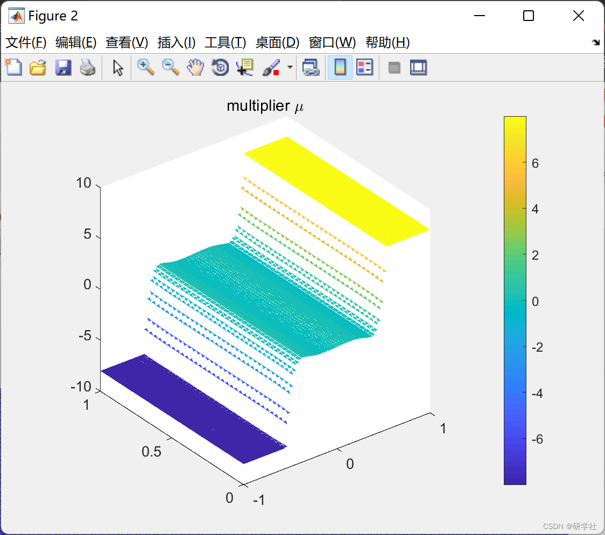
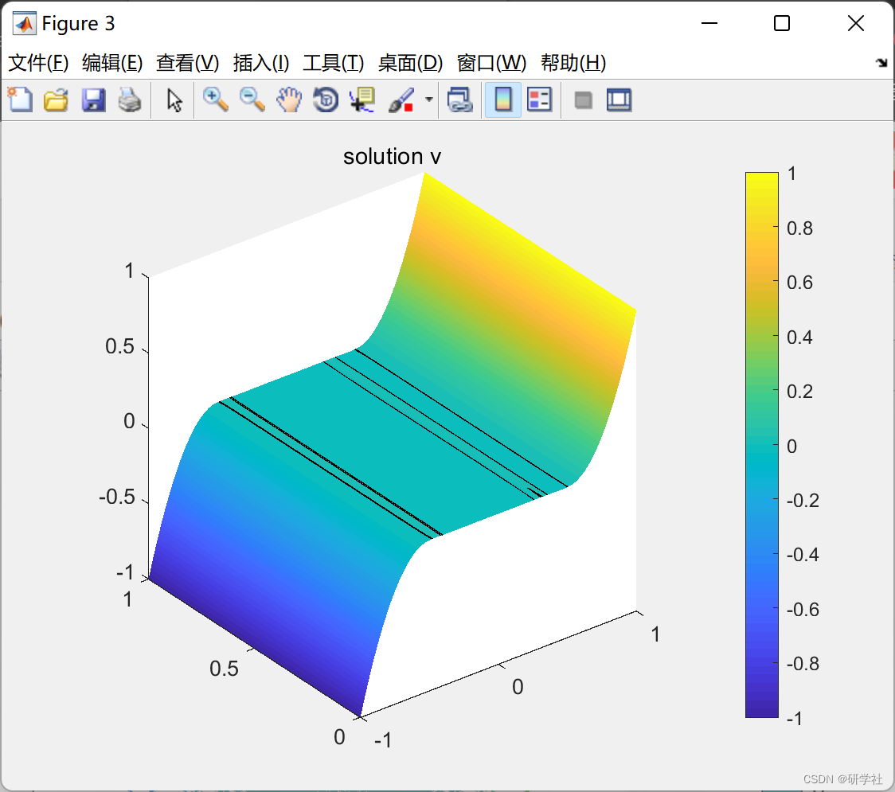
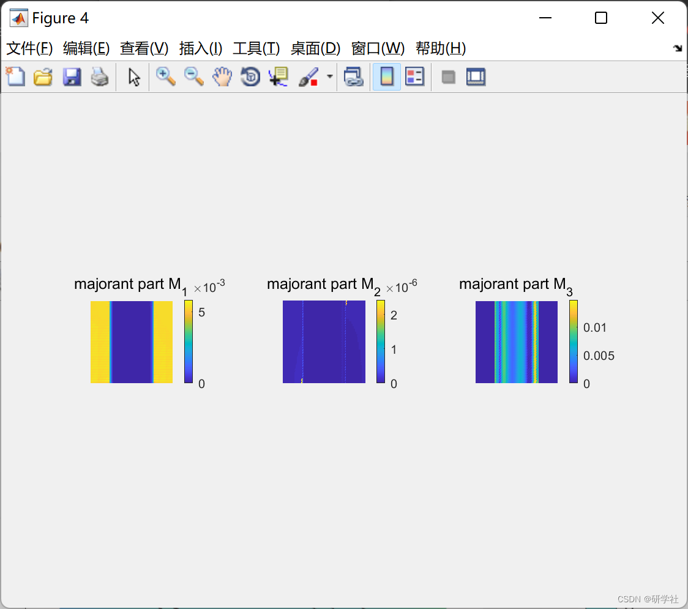
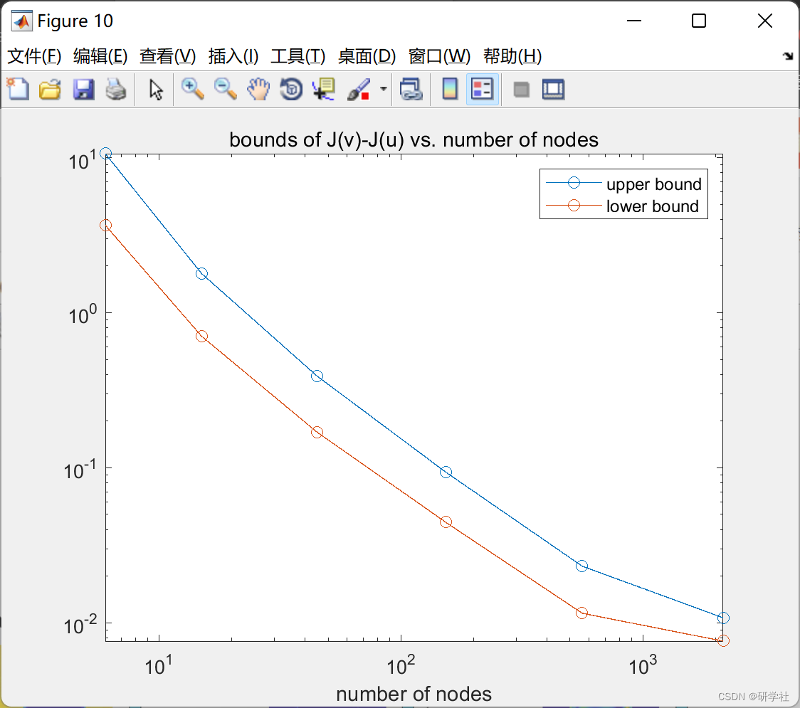

# FEMA approximation of two-phase obstacle problems and its posterior error estimation (implemented in Matlab)

💥💥💞💞 Welcome to this blog❤️❤️💥💥
🏆 Bloggers' Advantage: 🌞🌞🌞 The content of the blog strives to be rigorous in thought and clear in logic, for the convenience of readers.
⛳️ Mantra: "Those who travel a hundred miles may arrive at only half of their destination." 📜
Editor
For the problem of two-phase obstacles, we derive a fundamental error identity that produces a natural measure of the distance to the exact solution. For this measure, we derive a computable majority function that is effective for any function in the class of allowable (energy) functions. The proof shows that when and only when the function coincides with the minimizer, does the majority disappear. The results indicate that the corresponding estimate has no gaps, so it can be evaluated at any desired precision for any approximated accuracy.
📚2 Running Results Editing
Editor
Editor
Editor
Editor
Part of the code:
add_paths  
define_global_variables  
testing_on=0; %more figures than in the paper  
labels_on=1;  %figures labels on/off  
elements_frames_on=0;  
dirichlet_nodes_show=0;  
tricont_level_zero_value=0.0001;  %level set value for the free boundary  
%%%%%%%%% START OF SETUP %%%%%%%%%%%%%%%%%%%%%%%%%%%%%%%%%%%%%%%%%%%%%%%%  
example=1;                  % 1 or 2 implemented  
iterations_majorant=1e1;  
iterations_majorant_to_printout=[1:10 20:10:100 200:100:iterations_majorant];  
levels_energy_error=5;            %maximal level for the diference of energies  
levels_majorant=levels_energy_error;     %maximal level for majorant computation  
level_to_visualize=levels_energy_error;    %level to visualize  
if example==1  
level_exact_energy=levels_energy_error;    %level to estimate the exact energy for example 2 (known for example 1!)  
else  
level_exact_energy=levels_energy_error+1;    %level to estimate the exact energy for example 2 (known for example 1!)  
end  
testfolder = 'test2D';  % specify the test folder  
cd(testfolder)  
%load mesh;        % load initial mesh  
f = @loadfun;       % right hand side  
%  u = @exact;        % exact solution  
cd ..  
if example==1 %Example 1D computed using 2D  
alpha_plus=8; alpha_minus=8;  
nodes2coord = [0 0; 1 0; 2 0; 2 1; 1 1; 0 1];  
nodes2coord = nodes2coord - kron(ones(size(nodes2coord,1),1),[1 0]);  
elems2nodes = [1 2 5; 5 6 1; 2 3 4; 2 4 5];  
dirichlet = [3 4; 6 1];  
neumann=[1 2; 2 3; 4 5; 5 6;];  
if 0  
nodes2coord = [0 0; 2 0; 2 1; 0 1; 1 1/2];  
nodes2coord = nodes2coord - kron(ones(size(nodes2coord,1),1),[1 0]);  
elems2nodes = [1 2 5; 2 3 5; 3 4 5; 4 1 5];  
dirichlet = [1 2; 2 3; 4 1];  
neumann=[];  
end  
C_Omega=2/pi; %Friedrich's constant  
energy_exact=5+1/3;  
else %Example F. Bozorgnia  
alpha_plus=4; alpha_minus=4;  
nodes2coord = [0 0; 2 0; 2 2; 0 2; 1 1];  
nodes2coord = nodes2coord - kron(ones(size(nodes2coord,1),1),[1 1]);  
elems2nodes = [1 2 5; 2 3 5; 3 4 5; 4 1 5];  
dirichlet = [1 2; 2 3; 3 4; 4 1];  
neumann=[];  
energy_exact=13; %this value is only expected, maybe wrong  
C_Omega=sqrt(2)/pi;  %Friedrich's constant  
end  
%%%%%%%%% END OF SETUP %%%%%%%%%%%%%%%%%%%%%%%%%%%%%%%%%%%%%%%%%%%%%%%%%%  
%finding box parameters  
x_min=min(nodes2coord(:,1)); x_max=max(nodes2coord(:,1));  
y_min=min(nodes2coord(:,2)); y_max=max(nodes2coord(:,2));  
for level=0:level_exact_energy  
fprintf(' Level: %d \n', level)  
% uniform refinement  
if (level>0)  
tic  
[nodes2coord,elems2nodes,dirichlet,neumann] = refinement_uniform_2D(nodes2coord,elems2nodes,dirichlet,neumann);  
time_ref=toc;  
fprintf(' Mesh refined: [%f]\n',time_ref)  
end  
%calculate affine transformations for elements  
tic;  
[B_K,b_K,B_K_det] = affine_transformations(nodes2coord,elems2nodes);  
[elems2edges, edges2nodes] = get_edges(elems2nodes);  
signs      = signs_edges(elems2nodes);  
time_at = toc;  
fprintf(' Calculating affine transf., edge data, and edge signs: [%f]\n',time_at)  
nelems = size(elems2nodes,1);  
nnodes = size(nodes2coord,1);  
nedges = max(max(elems2edges));  
all_number_of_nodes(level+1)=size(nodes2coord,1);  
all_number_of_elements(level+1)=size(elems2nodes,1);  
fprintf(' NOF elements = %d, NOF nodes = %d, NOF edges = %d.\n', nelems, nnodes, nedges)  
% stiffness matrix assembly P1  
tic; K = stiffness_matrix_P1(elems2nodes,B_K,B_K_det); time1 = toc;  
fprintf(' Assembling P1 stifness matrix K [%f], ',time1);  
% mass matrix assembly  
tic; M = mass_matrix_P1(elems2nodes,B_K_det); time2 = toc;  
fprintf('P1 mass matrix M [%f]\n',time2);  
%extracts nodes from Dirichlet BC  
nodes_dirichlet=unique(dirichlet);  
nodes_dirichlet_left=nodes_dirichlet(nodes2coord(nodes_dirichlet,1)==x_min);  
nodes_dirichlet_right=nodes_dirichlet(nodes2coord(nodes_dirichlet,1)==x_max);  
nodes_dirichlet_bottom=nodes_dirichlet(nodes2coord(nodes_dirichlet,2)==y_min);  
nodes_dirichlet_top=nodes_dirichlet(nodes2coord(nodes_dirichlet,2)==y_max);  
%defining Dirichlet and free nodes  
if example==1  
nodes_dirichlet=unique([nodes_dirichlet_left; nodes_dirichlet_right]);  
v_dirichlet=zeros(nnodes,1);  
v_dirichlet(nodes_dirichlet_left,:)=-ones(size(nodes_dirichlet_left,1),1);  
v_dirichlet(nodes_dirichlet_right,:)=ones(size(nodes_dirichlet_right,1),1);  
%v_dirichlet(nodes_dirichlet_top,:)=(nodes2coord(nodes_dirichlet_top,1)).^3;  
%v_dirichlet(nodes_dirichlet_bottom,:)=(nodes2coord(nodes_dirichlet_bottom,1)).^3;  
else  
v_dirichlet=zeros(nnodes,1);  
v_dirichlet(nodes_dirichlet_left,:)= nodes2coord(nodes_dirichlet_left,2)-1;  
v_dirichlet(nodes_dirichlet_right,:)=nodes2coord(nodes_dirichlet_right,2)+1;  
v_dirichlet(nodes_dirichlet_top,:)=nodes2coord(nodes_dirichlet_top,1)+1;  
v_dirichlet(nodes_dirichlet_bottom,:)=nodes2coord(nodes_dirichlet_bottom,1)-1;  
end  
nodes_free=setdiff((1:nnodes)',nodes_dirichlet);  
%define Neumann edges  
edges_neumann=get_boundary_edges(edges2nodes,neumann);  
% extracts matrices from K  
K_ii=K(nodes_free,nodes_free);  
K_dd=K(nodes_dirichlet,nodes_dirichlet);  
K_id=K(nodes_free,nodes_dirichlet);  
if level==level_to_visualize  
figure(1);  
show_mesh(elems2nodes,nodes2coord);  
if labels_on  
if dirichlet_nodes_show  
hold on  
plot(nodes2coord(nodes_dirichlet,1),nodes2coord(nodes_dirichlet,2),'.r', 'MarkerSize',15)  
hold off  
title('visualization mesh + Dirichlet nodes (red circles)');  
else  
title('visualization mesh');  
end  
view(2);  
end  
axis equal; axis tight;  
end  
🎉3 References
🌈4 Matlab code and detailed article

## Images

<!-- PAYMENT_BLOCK -->

## Get this dataset

- Payment link (Stripe): [Buy now](https://buy.stripe.com/3cs8yP7sY87d0vu9AB)
- Payment QR code: 

<!-- /PAYMENT_BLOCK -->
